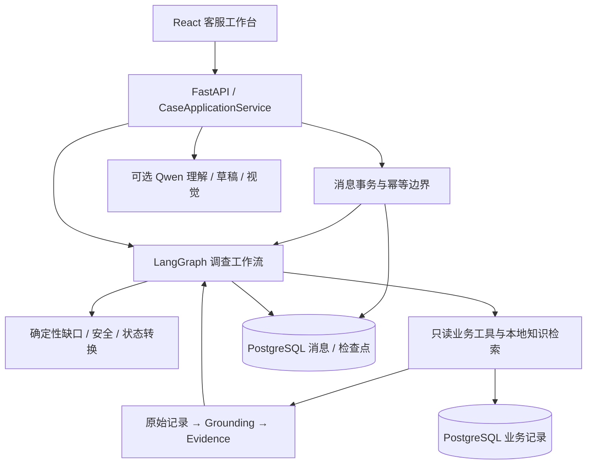

# Resonique

**面向美妆售后客服的有状态调查助手：整理消费者反馈、订单与服务记录，追问缺失信息，并为人工审核准备有证据依据的下一步建议。**

消费者说“用了之后不舒服”，并不意味着已确定使用时间、涉及产品或原因。Resonique 将业务事实、消费者自述、AI 观察和未知信息分开记录，让客服先理解情况，再决定如何回应。

## 当前能做什么

项目持续迭代中，**尚未公开上线，也未完成真实业务交付**。当前仓库可在本地运行 React 工作台、FastAPI API、LangGraph 调查流程和 PostgreSQL：

- 展示案件证据、来源、信息缺口、调查状态与 Context Passport，支持人工审批和调查续接。
- 按确定性规则选择下一步问题、限制追问与步骤数；严重反馈进入人工处理，不自动作医疗诊断或因果归责。
- 保存调查检查点及新接收的消费者消息，支持刷新、API 重启后的读取，以及稳定请求 ID 重放。
- 保留工具失败和恢复历史，通过 API 显式发起受约束的只读订单查询恢复。
- 可选接入 Qwen 进行结构化理解、回复草稿和图片观察；模型候选必须经过领域校验。

默认界面围绕 S00154 演示案件，使用明确标记的固定演示样本。它展示的是客服辅助流程，不是已经连接品牌客服系统的在线产品。

## 界面与演示

可按下方步骤本地体验客服工作台。现有[真实 Chrome 验收截图与报告](docs/W4_DELIVERY.md#新浏览器证据)使用 DEMO_FIXTURE 演示样本及 FakeModelProvider 测试模型，不代表真实客户服务或真实 Qwen 效果。操作路径见[演示指南](docs/DEMO_OPERATOR_GUIDE.md)；暂无公开在线演示地址或当前版本演示视频。

## 从反馈到下一步行动

| 环节 | 当前实现 | 使用边界 |
| --- | --- | --- |
| 查看上下文 | 汇总订单、服务历史、证据来源、历史问题与工具结果 | 购买记录只证明购买，不证明实际使用或因果关系 |
| 补齐信息 | 围绕首次使用、反馈出现时间、近期护理变化、严重程度追问 | 缺口、问答去重、预算和状态合法性由代码决定 |
| 接收新消息 | 持久化原文、角色、接收顺序、版本与 Evidence 引用；无有效 Evidence 也可保存原文 | 新消息理解需要模型；模型不可用时返回 503，不假装接收成功 |
| 准备回应 | 展示服务策略、下一步建议；可选生成回复草稿 | 生成与视觉能力需要真实模型配置；审批不代表实际发送或退款 |
| 交接与恢复 | Context Passport 保留依据；检查点恢复调查；人工显式恢复只读订单工具 | 恢复通过 API/离线 CLI 操作，限定本地单 API 工作进程，不自动重试外部写操作 |

官方工作簿导入、图片观察和本地知识检索已有实现，但官方数据需另行获得授权与文件，真实视觉调用需要模型配置。生产鉴权、多租户、跨主机恢复隔离及真实客服系统写入尚未完成。

## 工程设计

1. **证据可追溯，推断不冒充事实。** `Evidence` 保留结构化来源类型、具体 source ID、案件身份与证据类型；Grounding 是业务原始记录转为 Evidence 的边界。记忆和 Context Passport 从证据投影，不另造事实。已有 `original_message` 与入站原文不一致时，写入、读取和重放均拒绝冲突，不覆盖任一来源。见[领域模型](backend/app/domain/evidence.py)与[消息边界](backend/app/api/services/message_persistence.py)。
2. **调查可以暂停和续接。** LangGraph 编排确定性决策与领域转换，行动意图和生命周期状态分开；问题、工具调用、转换事件与版本化 State 一起进入 PostgreSQL JSONB 检查点。恢复时校验领域约束与关系元数据，CAS 拒绝陈旧版本。见[工作流](backend/app/agent/workflow.py)与[检查点](backend/app/persistence/checkpoints.py)。
3. **消息和调查状态原子提交。** 独立入站消息表保存原文；事务绑定检查点适配器将消息、Evidence 和中间状态放在同一事务提交。模型理解发生在锁外，锁内再次检查请求重放及 revision，避免持锁等待模型。GET 使用同一 REPEATABLE READ 快照，前端以服务端消息清单恢复界面。见[消息持久化实现](backend/app/api/services/message_persistence.py)。
4. **区分重放、竞争和提交不确定。** 同案件稳定 message ID 绑定原文与首次请求版本；已提交请求重放返回原回执和当前视图，不再调用模型或工具。同 ID 改内容拒绝，案件行锁与版本检查控制并发；回包丢失可用原请求确认。未提交并发请求仍可能各调用一次模型，整体回滚后只读查询也可能再次执行，**不承诺外部 exactly-once**。
5. **失败历史保留，恢复需要显式领取。** 逻辑调用与每次 attempt 分离；revision CAS 领取结合进程内一次性执行许可，持久化 PENDING 不等于可以直接重执行。人工恢复仅允许 `get_order_history`，检查失败类型、安全边界、步骤预算和旧进程退出声明。见[恢复服务](backend/app/services/tool_recovery.py)；操作者和进程退出字段目前是声明，尚非认证或跨主机 fencing。

## 系统架构与技术栈



前端使用 React 19、TypeScript、Vite、Tailwind；后端使用 Python 3.12+、FastAPI、Pydantic、LangGraph、SQLAlchemy、psycopg 与 Alembic。Docker Compose 启动 PostgreSQL 16、API 和 nginx 托管的前端。模型是可选适配器，安全判断不交由 LLM 全权决定。更多边界见[架构说明](docs/ARCHITECTURE.md)。

## 快速启动：Docker Compose

需要 Git、支持 Compose 的 Docker（Windows 推荐 Docker Desktop / Linux containers）、可用的 5432 / 8000 / 5173 端口，以及首次下载镜像和依赖的网络。仅走容器路径无需在宿主机安装 Python 或 Node。

以下 PowerShell 命令从获取代码开始：

```powershell
git clone https://github.com/xingnan-dev/Empathy-Copilot.git
cd Empathy-Copilot
Copy-Item .env.example .env
docker compose up --build -d
docker compose ps
```

保留 `.env` 中 `LLM_API_KEY` 与 `OFFICIAL_DATASET_PATH` 为空，即可先体验本地演示。不要提交 `.env` 或真实密钥。等待三个服务 healthy 后访问：

- 工作台：[localhost:5173](http://localhost:5173/)
- API 健康检查：[localhost:8000/health](http://localhost:8000/health)
- API 文档：[localhost:8000/docs](http://localhost:8000/docs)

Compose 后端启动命令依次执行 Alembic 迁移、幂等演示数据 seed 和 Uvicorn；API 初始化固定演示案件。演示数据来自仓库本地样本，不要求官方工作簿。

| 配置 | 可体验范围 |
| --- | --- |
| 无模型密钥、无官方文件 | 查看固定案件、来源、缺口、状态、已有聊天；体验已有确定性审批/续接路径。新消息理解返回明确的模型不可用错误，不能体验成功接收 |
| 配置真实模型 | 在 `.env` 填写 `LLM_PROVIDER`、`LLM_MODEL`、`LLM_API_KEY`、`LLM_BASE_URL`；视觉另需 `VISION_PROVIDER`、`VISION_MODEL`。可尝试理解、草稿与视觉路径，受网络、模型权限及校验结果影响 |
| 获授权的官方工作簿 | 放入 `competition_data/official.xlsx`，设置 `OFFICIAL_DATASET_PATH=/competition-data/official.xlsx`，支持相应官方案例；不要将文件提交 Git |

当前 Compose 将本地数据库凭据固定在配置内，`.env.example` 的宿主机连接示例不用于覆盖容器连接，单改 `.env` 的密码也不会改变 PostgreSQL 凭据。原生开发、模型参数、官方案例及恢复 API/CLI 详见[运行指南](docs/COMPETITION_RUN_GUIDE.md)。该指南的历史分支 clone 示例保留原验收上下文；首次体验当前版本使用本页默认分支命令。

```powershell
# 查看启动失败原因
docker compose logs backend
# 停止服务，保留容器和数据
docker compose stop
```

已有数据库升级前须停写、备份；当前迁移包含 `20261115_0003` 入站消息表。有消息时降级会拒绝删表，不能直接删除新表后继续接收。不要为重置演示随意删除已有数据卷。

## 测试与验证

以下为已保存的分轮执行记录，各轮成绩独立，不合计为一个通过数。

| 验证层级 | 日期 / 适用版本 | 主要结果与范围 |
| --- | --- | --- |
| 后端领域与 API（含数据库集成） | 2026-11-15，消息持久化修复轮 | **246 通过、0 失败、27 跳过、1 排除**；27 项依赖官方工作簿，真实 Qwen 按标记排除。[JUnit](backend/evaluation_output/message-complete-39185dfb90664ee09717c06918d3c8b4/tests.xml) / [日志](backend/evaluation_output/message-complete-39185dfb90664ee09717c06918d3c8b4/tests.log) |
| 真实 PostgreSQL 16 | 同轮，独立临时数据库 | 纳入上述后端成绩，覆盖原子回滚、双连接及跨进程竞争、重启恢复；不另重复计数。后续 LIVE 原文溯源定向补验 **31 通过、0 失败、0 跳过**。[范围](docs/W4_DELIVERY.md#后端与数据库验证) / [补验 JUnit](backend/evaluation_output/message-provenance-20261115/verified.xml) |
| 前端 | 2026-11-15，消息持久化修复轮 | **6 项测试通过**，typecheck / lint / build 通过；这些测试与浏览器验收分开。[执行记录](docs/W4_DELIVERY.md#后端与数据库验证) |
| Chrome 157 + Playwright | 2026-11-15，消息修复后验收 | **九模式、90 项断言通过**，覆盖六条验收路径；真实前端/API/临时 PG，使用固定或空候选的 **FakeModelProvider**，无真实 Qwen / 官方工作簿。其他浏览器未验证。[原始报告](backend/evaluation_output/browser-42cdc9de3c7c474583f96132c6592061/report.json) / [范围](docs/W4_DELIVERY.md#新浏览器证据) |
| GitHub CI | 2026-11-15，main `2d0707f` | **backend / postgres / frontend 三个 job 通过**；外部工作簿及真实模型测试依配置跳过，完整独立进程故障实验不在 CI 内。[Actions](https://github.com/xingnan-dev/Empathy-Copilot/actions/runs/43707162075) / [配置](.github/workflows/basic-ci.yml) |

详细版本、原始失败及后续修正保留在 [W4 验证报告](docs/W4_DELIVERY.md)。人工只读恢复的独立进程故障实验见 [W3](docs/W3_VALIDATION.md) 与[观测补验](docs/W3_F5_SUPPLEMENT.md)，适用于其记录版本，不代表最新消息修复后的重跑。上述结果不验证真实模型质量、生产负载或外部系统 exactly-once。

## 已知限制与文档

- 尚无 HTTP 鉴权、生产权限体系或跨主机恢复保证；当前固定本地凭据及单进程恢复边界不适合直接公网部署。
- 官方数据公开/商用许可与原文隐私、保留期限尚待确认；没有通用消息编辑、删除、分页接口，不从 Evidence 补造旧聊天。
- 真实模型与官方工作簿依赖的测试未在上述验收中执行；不能据此宣称模型质量、医疗效果、用户规模或业务收益已验证。
- 前端仍有已记录的 minimatch 间接依赖风险；镜像 CVE 扫描、其他浏览器及生产负载未验证。详见[依赖审查](docs/FRONTEND_DEPENDENCY_REVIEW.md)。
- Python 依赖未完全锁定，首次安装可能得到不同解析版本；既有恢复和界面演示范围不等于完整生产客服平台。

| 入口 | 内容 |
| --- | --- |
| [运行指南](docs/COMPETITION_RUN_GUIDE.md) / [演示指南](docs/DEMO_OPERATOR_GUIDE.md) | 环境、数据来源、原生开发与操作路径 |
| [架构说明](docs/ARCHITECTURE.md) | 技术边界与可核实的贡献说明 |
| [项目状态](docs/PROJECT_STATE.md) / [消息持久化契约](docs/phases/PHASE_MESSAGE_PERSISTENCE.md) | 最新完成范围与存储/重放契约 |
| [W4 交付记录](docs/W4_DELIVERY.md) / [验证原始目录](backend/evaluation_output/) | 按轮次保留的执行证据、失败与修正 |
| [AGENTS.md](AGENTS.md) / [PRD](docs/PRD.md) / [设计](docs/AGENT_DESIGN.md) | 开发约束与基础设计 |
| [历史阶段](docs/phases/) / [历史提交清单](docs/SUBMISSION_MANIFEST.md) | 早期基线及历史材料 |

早期 PRD / Agent Design 中“不含数据库、前端、模型或部署”等限制是当时阶段范围，已被后续代码实现推进；项目状态及历史报告中的“待评审”“刷新部分通过”也须结合后续完成记录阅读，本页按当前 main 实现及对应执行证据介绍。

项目在既有团队基线上持续开发，包含 Codex 辅助的代码、测试与文档工作；不将提交署名等同于全部由个人纯手工独立完成。具体贡献边界见[架构说明](docs/ARCHITECTURE.md#verifiable-contribution-boundaries)。
