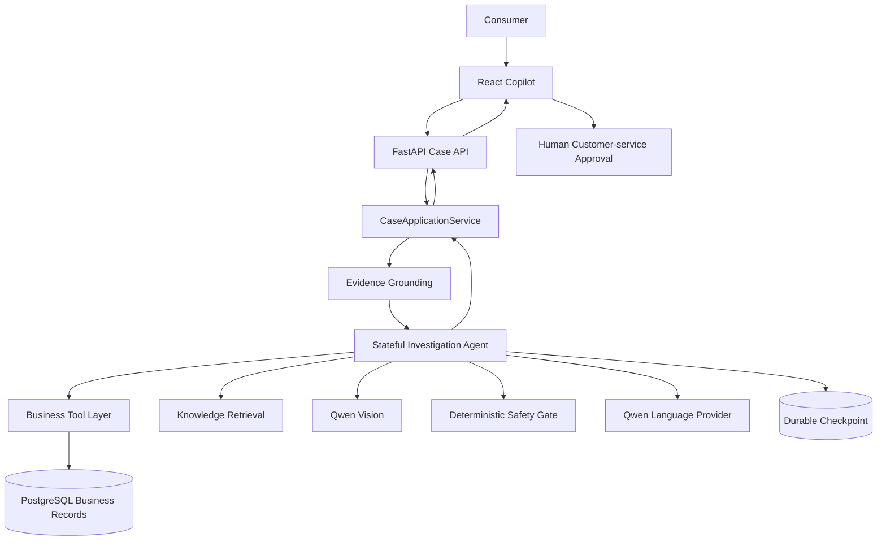

# Resonique Architecture

The React plugin renders an API projection; it does not own investigation truth. FastAPI delegates
to `CaseApplicationService`, which preserves the boundary between raw business/tool results and
grounded Evidence. The stateful workflow evaluates gaps and chooses legal actions. PostgreSQL
stores business records and versioned checkpoints. Qwen may propose structured extraction,
questions, drafts, or image observations; deterministic validation owns provenance, gap state,
attribution, safety, lifecycle, and high-impact actions.

**LLM proposes. Domain validates. Agent decides. Human approves.** There is no multi-agent system,
knowledge graph, fine-tuning, or automatic medical/causal verdict.
