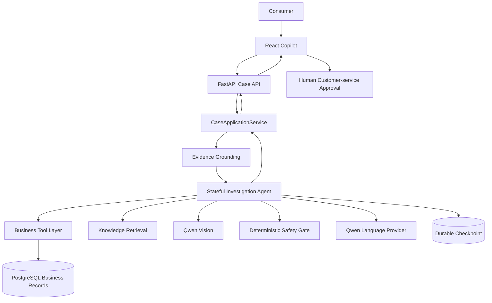

# Resonique Architecture

The React plugin renders an API projection; it does not own investigation truth. FastAPI delegates
to `CaseApplicationService`, which preserves the boundary between raw business/tool results and
grounded Evidence. The stateful workflow evaluates gaps and chooses legal actions. PostgreSQL
stores business records and versioned checkpoints. Qwen may propose structured extraction,
questions, drafts, or image observations; deterministic validation owns provenance, gap state,
attribution, safety, lifecycle, and high-impact actions.

**LLM proposes. Domain validates. Agent decides. Human approves.** There is no multi-agent system,
knowledge graph, fine-tuning, or automatic medical/causal verdict.

## Current recovery increment and design decisions

The existing React/FastAPI/Qwen/vision integration, Evidence provenance, deterministic safety and
attribution, LangGraph investigation, PostgreSQL checkpoints, business repositories and evaluation
remain part of the project. E3.1/E3.2 adds classified durable tool failures, explicit readonly
recovery, preserved attempt/request history and process-level validation; it does not enable
automatic refunds, sending or autonomous retries.

1. A logical call identifies a query demand; separate attempts preserve failed/interrupted history.
   Effective-leaf selection permits continuation after a legitimate successful successor without
   hiding unrelated unresolved failures. This adds validation complexity but retains provenance.
2. PostgreSQL revision CAS chooses a claimant; a non-serializable, single-use in-process permit
   allows only that claimant to execute. Stored PENDING is never treated as a replayable execution
   command. This prevents blind repetition but does not promise external exactly-once effects.
3. Recovery is explicit, readonly and human-gated. Local process exit is established by the
   experiment manager, while application operator fields are declarations. This keeps the
   demonstration bounded; multi-host fencing and authenticated operator identity remain future work.

## Verifiable contribution boundaries

The Team Oasis competition baseline is preserved by `v1.0.0-competition-submission`; see the
[historical manifest](SUBMISSION_MANIFEST.md), not a new competition retrospective.
Post-competition traceable implementation/test units are 888e65e (models/chains), 85c6545 (real old
snapshots), c5ecec8 (executor/evidence), 4cc5fac (claim/permit), 9dbc2f2 (API/CLI), da13105 (database
acceptance), 609e12a (process harness), ae294ca (initial evidence), and 00b9463 (F5 observer correction).
The project owner supplied direction and communication-area review. Codex assisted with code,
tests, documentation, execution and Git operations in this chat. Commit authorship alone cannot
establish individual design ownership or hours contributed; those personal/team allocations are
**pending owner supplementation**. These records do not claim independent human implementation
of AI-assisted changes. [W2](W2_VALIDATION.md), [W3](W3_VALIDATION.md) and [F5](W3_F5_SUPPLEMENT.md)
state measurement boundaries and preserve the initial observation limitation.
